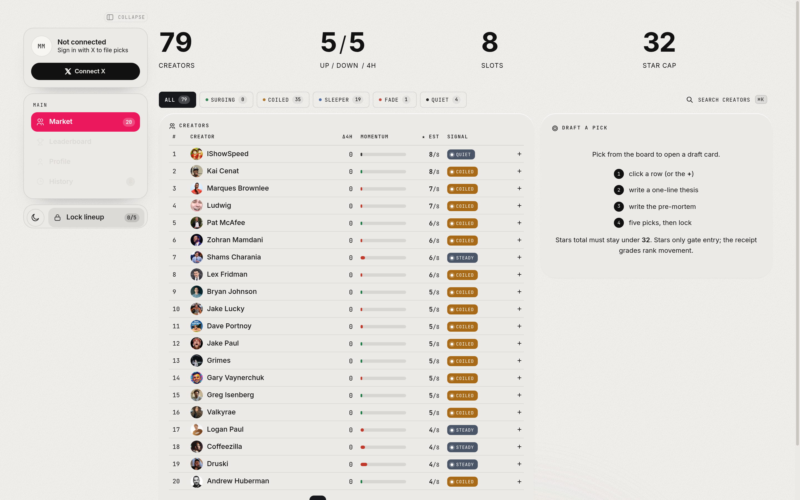
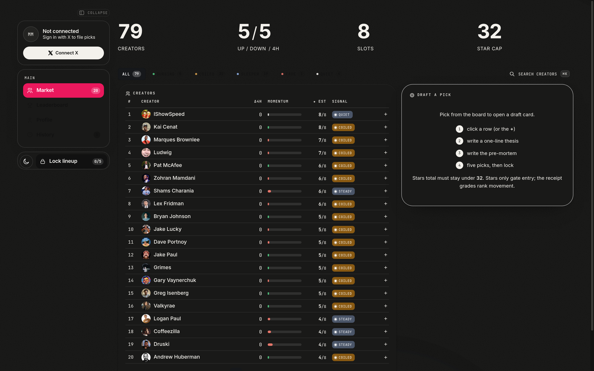
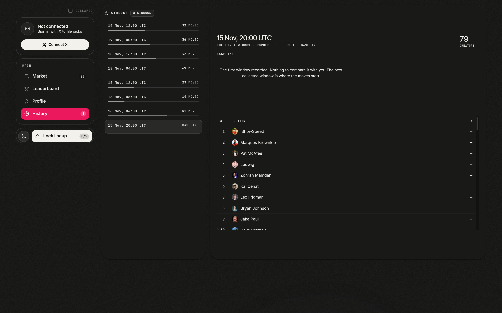

<div align="center">

# Motion Draft Room

### Five creators. Five reasons. One grade.

A draft room for [Motion Official Game](https://motion.game) that keeps the receipt on your calls.

**Mogathon submission** · built by [@frianowzki](https://x.com/frianowzki)

[**Open the app**](https://motion-draft-room.vercel.app) · [How a pick gets graded](#how-a-pick-gets-graded) · [Honest limits](#what-this-is-not)

</div>



---

## The gap it fills

Motion hands you a leaderboard that says where everyone stands *right now*. Then the next slot lands and that answer is gone. Rank deltas arrive in four-hour slices and nothing accumulates, so you can see the present but not a trend, and nothing holds you to what you predicted.

Motion Draft Room does four things about that:

- **It remembers.** A scheduled collector snapshots all 79 creators every four hours, so 24h and 72h movement, acceleration and volatility become measurable instead of guessed.
- **It forecasts in the open.** Every creator gets a momentum score with a formula you can read, a star estimate on the game's real 1–8 scale, and a tag: `SURGING`, `COILED`, `SLEEPER`, `FADE`, `QUIET` or `STEADY`.
- **It asks you why.** A lineup is five creators under a 32-star cap, and every pick needs a one-line thesis plus a pre-mortem. A pick without reasoning does not go through, so one click cannot build a lineup here.
- **It grades itself.** When the next slot lands, your locked lineup is scored against what actually moved, and the receipt goes into a public book with a hit rate next to your name.

## How a pick gets graded

A real receipt, locked 18 Nov 04:00 UTC and settled one window later:

| Pick | Card | Thesis | Move |
| --- | --- | --- | --- |
| IShowSpeed | Legendary | GTA 6 is live today and he will definitely stream it | 0 |
| Kai Cenat | Common | he does IRL stream | **+2** |
| Ansem | Common | Callout a token and getting at least x3 | **−2** |
| Michael Saylor | Common | post something about bitcoin | 0 |
| Brian Armstrong | Common | making a post about $BASE | **+1** |

Net rank movement `+1`, filed as a settled receipt. Kai Cenat earned it and Ansem lost it back.

That is the point of the book. The reasoning is written down before the window opens, so a lucky call and a called shot look different afterwards.

<p align="center">
  
  
</p>

## The app

- **Market** lists all 79 creators with four-hour change, momentum bars, estimated stars and a signal pill. Filter by signal or search by name. Picked creators get an accent block across the row so a lineup reads at a glance.
- **Draft** opens on a row click. Two steps, thesis then pre-mortem, both with character counters. Rarity is recorded on the receipt and previewed in the tier colour.
- **Leaderboard** ranks players by settled hit rate. It stays empty while there is not enough graded history to rank anyone, and says so instead of padding the table.
- **Profile** holds your lineup as a list, your locked receipts and your record.
- **History** is the append-only record of collected windows: what moved, in which slot, against the window before it. Nothing is extrapolated. A move is claimed only between two windows that both exist.
- **Dark and light** are both first class. Nothing in the UI is a Framer component wearing someone else's theme.

## Running it

```bash
git clone https://github.com/frianowzki/motion-draft-room
cd motion-draft-room

python3 collector/snapshot.py --dry-run   # fetch Motion's board, print it, write nothing
python3 collector/snapshot.py             # take a real snapshot
python3 engine/score.py                   # rebuild signals from snapshots
```

Standard library only. Nothing to install.

```
collector/snapshot.py    fetch, normalise, append one snapshot
engine/score.py          snapshots -> data/signals.json (momentum, tags)
engine/rarity.py         the Score Boost table, as one named constant
data/snapshots/*.json    append-only history, one file per four-hour slot
data/latest.json         most recent snapshot
api/                     receipts, profiles, signals, X OAuth
.github/workflows/       cron every four hours, commits to the `data` branch
```

The collector runs on GitHub Actions (`7 */4 * * *`), so no machine has to stay awake. The app reads the `data` branch at request time, which means a new window shows up without a redeploy.

## What the game rules actually say

Read from [docs.motion.game](https://docs.motion.game) on 19 Nov 2026. Mirrored in `data/game-rules.json`.

| Rule | What the docs say |
| --- | --- |
| Tournament | Weekly, Monday to Friday |
| Lineup submission | Opens Saturday, editable until lock |
| Lock and start | Lineups lock Mon 07:00 ET, tournament starts Mon 09:00 ET |
| Results | Finalised Friday 5:00 PM ET, cards unlock after that |
| Score updates | Every four hours, Monday to Friday |
| Lineup | Exactly five cards, five different creators |
| Star cap | Set per tournament; the docs' worked example is 32 |
| Stars | 1–8, from trailing 14-day relative performance |
| Stars in scoring | None. They gate eligibility and pack odds only |
| Lineup Score | Σ (Creator Motion Score × card Score Boost) |
| Score Boost | By card rarity: Common, Rare, Epic, Legendary |
| Motion Score | X + Instagram + TikTok + YouTube engagement, normalised against the creator pool. Not public |
| Pack | Starter Pack, $100, seven random cards, no duplicate creators |
| Rarity odds | Common 75%, Rare 20%, Epic 4.5%, Legendary 0.5% |
| Star odds | 1★ 16.25% down to 8★ 8.75% for the first card drawn |
| Trade-in | 12 cards burned for one new Starter Pack |

Two things this project changed after reading the rules: the draft cap moved from 15 to **32** (five cards on a 1–8 scale cannot fit under 15), and the star estimate switched to the real 1–8 scale instead of an invented 1–5.

### Score Boost is modelled as an assumption, and labelled as one

The formula is public. The numbers in it are not. The docs guarantee `Legendary > Epic > Rare > Common` and stop there: no multipliers, no per-tournament boost limit, no rule for how boosts combine. Motion Score is not public either.

So `engine/rarity.py` does not pretend to reproduce a Lineup Score. It keeps the boost table in one constant (`DEFAULT_BOOST`, marked assumed), projects a lineup from a rank-based stand-in, and returns the assumptions next to every number. Rarity is written on the receipt and **never graded on**, because grading against invented multipliers would turn a guess into a fake score. The UI prints `projected 3.42 · boosts ×5.60` and says in the same line that this is not the game's Lineup Score.

When Motion publishes real multipliers, change that one constant and the engine, the API and the UI all follow.

## Where the numbers come from

One source: `https://leaderboard.motion.game/api/leaderboard`, Motion's own JSON, unauthenticated, 79 rows with `position`, `delta` and `isNew` plus `asOf`, `capturedAt` and `baselineCapturedAt`.

There is deliberately no third-party fallback. A snapshot from a different source is a different measurement, so a failed fetch fails loudly instead of quietly recording something else.

## What this is not

- **Not a Lineup Score calculator.** See the boost section above.
- **Not a card marketplace.** It reads rank and delta, not card supply or prices.
- **Not backfilled.** Early history came from manual runs, so some of it sits inside one slot. `delta24h` and `delta72h` stay blank until at least three distinct four-hour windows exist (about 12 hours), and acceleration stays blank before that.
- **Not a ranked table when there is nothing to rank.** The leaderboard is empty because grading needs settled receipts. A table padded with invented entries would be worse than an empty one.
- **Not immune to a silent API change.** Motion's leaderboard endpoint is undocumented. `collector/snapshot.py` degrades to the aggregator and then to HTML parsing, and refuses to write a half-empty snapshot.

## Stack

Plain HTML, CSS and JavaScript on the client, Python on the function side, Vercel for hosting, GitHub Actions for the collector, Supabase for the receipt book. No client framework, no build step beyond copying files, no secrets in the browser.

## Licence

Source is public for judging. Motion, its leaderboard data and its card art belong to Motion.
